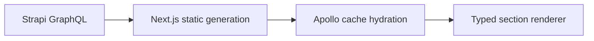

# Content GraphQL Web

A Next.js frontend that turns Strapi GraphQL content into a page of reusable header, carousel, and two-column sections. Apollo loads the homepage during static generation and hydrates the client cache. The section components have focused Jest tests.

## Explore the implementation

- `pages/index.tsx` fetches and renders the homepage.
- `components/HomePageSections.tsx` selects a component for each CMS section.
- `graphql/cms/homepage.graphql` defines the query; adjacent generated files hold its types and hooks.
- `lib/apollo/cms-client.ts` creates separate server clients and merges the browser cache.



## Run against your CMS

Use the Node runtime supported by the versions in `package.json`. This is a Next.js 15.5 / React 18 codebase. A compatible Strapi instance with the homepage schema is required; the backend is not included here.

```sh
cp .env.example .env.local
npm install
npm run dev
```

Set `STRAPI_URL` to your GraphQL endpoint and `STRAPI_CMS_URL` to your CMS origin. Supply your own server-side secrets only where authentication requires them. The development server listens on **3001**. Never put a privileged token in a `NEXT_PUBLIC_` variable.

`npm test` exercises section rendering. `npm run gen` regenerates GraphQL types against the schema configured in `graphql.config.yml`; `npm run build` also needs the CMS because `getStaticProps` queries it.

## Scope and next steps

This repository began as a CMS frontend exercise. It demonstrates typed content rendering rather than a complete editorial platform. Useful next work is a CMS-independent fixture mode, a deliberate empty-content state, and a screenshot of the three section types using sample copy. The CMS must enforce authorization; a frontend rendering boundary cannot provide it.

## Runtime and contract checks

Use Node 22 and npm for this workspace. Next.js is pinned to 15.5.29, React to 18.3.1, and `package-lock.json` records the resolved graph. Code-generation packages are development dependencies; maintained versions and a patched GraphQL Tools override were checked with a synthetic schema fixture. The resolved lockfile had no high or critical advisory matches at review time; moderate/low tooling advisories remain.

TypeScript checking and six component tests passed. The two-column renderer supports both the legacy flat image response in the checked-in operation and the nested `attributes` shape in the schema types. The test fixtures cover both. Confirm the deployed Strapi schema before regenerating the real query; the CMS-dependent production build was not run without that service.
